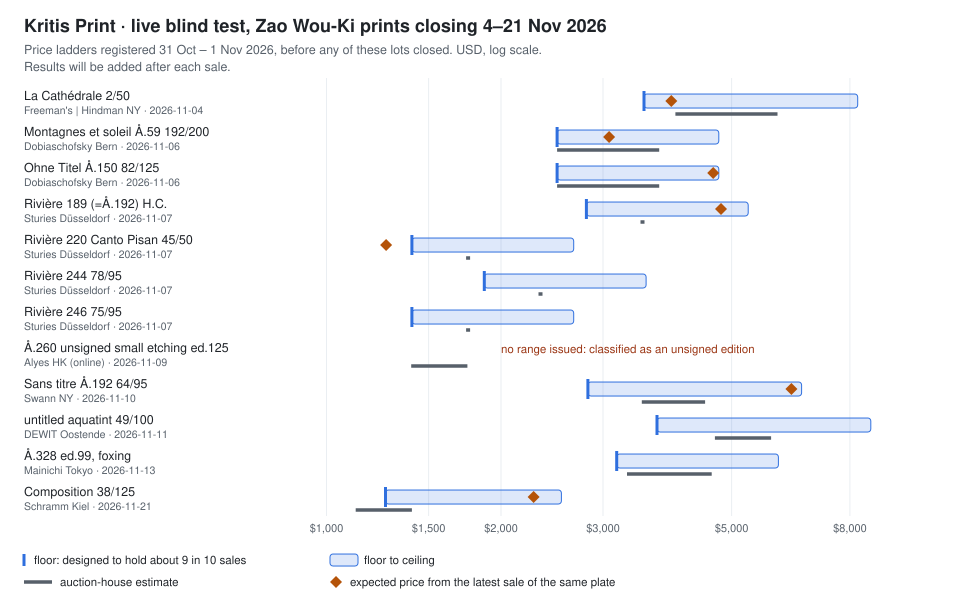

# Kritis Print: example output

This page shows what Kritis Print produces, using real lots and the tool's actual output. The source code and datasets remain private; the figures below are copied from the tool's output files.



*The animation follows one real lot through the three steps. Artwork image via WikiArt (fair use), © Zao Wou-Ki; sales data from public auction results.*

## 1. One lot, end to end

**Input.** Zao Wou-Ki, *Montagnes et soleil* (1951), lithograph, signed, numbered 192/200, catalogue raisonné Ågerup 59. Dobiaschofsky, Bern, sale of 6 November 2026. Estimate CHF 2,000–3,000 (about US$2,500–3,750).

**Output** (registered 1 November 2026, five days before the sale; key fields, USD):

```json
{
  "object_class": { "class": "signed_limited", "reasons": ["signed and numbered or edition stated"] },
  "plate": "zao_wou_ki:Agerup:59",
  "plate_basis": "catalogue_ref",
  "edition": { "edition_number": "192", "edition_size": 200, "signed": true },
  "same_plate_36m": { "n": 6, "median_usd": 3331, "last_date": "2026-05-19" },
  "mid": 3073,
  "mid_confidence": "high",
  "anchor_kind": "estimate",
  "anchor": 3125,
  "floor": 2500,
  "top": 4754,
  "band": 1.9,
  "confidence": "medium",
  "thresholds": { "suspect_below": 1250, "cheap_below": 2125 }
}
```

**How to read it.**

1. **What the object is.** The tool first decides whether the lot is a signed limited original print. Only signed editions and proofs receive a price range. Reproductions, book and magazine pages, and unsigned editions are excluded, because their sales do not belong to the same market.
2. **Which plate it is.** The catalogue number identifies the plate. It has 19 recorded auction sales since 2014. Prices have come down: six sales in the three years before registration had a median of US$3,331, against US$3,300–10,300 between 2014 and 2022. The most recent sale, adjusted for the difference between auction houses, implies about US$3,073.
3. **The price ladder.** The floor is US$2,500, the level below which this kind of sale rarely falls; it is calibrated so that about nine in ten comparable sales land at or above it. The ceiling is US$4,754.
4. **A verdict for any asking price.** For a dealer's or platform's asking price, the tool says where it sits. Below US$2,125 is cheap. Below US$1,250 the object should be checked before anything else, because a genuine impression rarely sells that low.

Every output also carries a manifest: the protocol version, the parameters and a checksum for each input file. Any figure can be traced back to the data snapshot it came from.

## 2. A live blind test, published before the results

Twelve Zao Wou-Ki prints were offered at eight auction houses between 4 and 21 November 2026. The tool's ranges for all twelve were fixed and committed to version control on 31 October and 1 November, before any of them closed. Results are added to the table as each sale is reported; nothing above the result column is changed afterwards.



| Closes | Lot | House | Estimate (USD) | Floor | Ceiling | Result |
| --- | --- | --- | --- | --- | --- | --- |
| 4 Nov | *La Cathédrale* 2/50 | Freeman's \| Hindman, New York | 4,000–6,000 | 3,531 | 8,255 | pending |
| 6 Nov | *Montagnes et soleil* Å.59, 192/200 | Dobiaschofsky, Bern | 2,500–3,750 | 2,500 | 4,754 | pending |
| 6 Nov | *Ohne Titel* Å.150, 82/125 | Dobiaschofsky, Bern | 2,500–3,750 | 2,500 | 4,754 | pending |
| 7 Nov | *Rivière* 189 (= Å.192), H.C. | Sturies, Düsseldorf | 3,510 | 2,808 | 5,340 | pending |
| 7 Nov | *Rivière* 220, *Canto Pisan* 45/50 | Sturies, Düsseldorf | 1,755 | 1,404 | 2,670 | pending |
| 7 Nov | *Rivière* 244, 78/95 | Sturies, Düsseldorf | 2,340 | 1,872 | 3,560 | pending |
| 7 Nov | *Rivière* 246, 75/95 | Sturies, Düsseldorf | 1,755 | 1,404 | 2,670 | pending |
| 9 Nov | Å.260, unsigned etching, ed. 125 | Alyes, Hong Kong (online) | 1,400–1,750 | not issued | not issued | pending |
| 10 Nov | *Sans titre* Å.192, 64/95 | Swann, New York | 3,500–4,500 | 2,825 | 6,604 | pending |
| 11 Nov | Untitled aquatint, 49/100 | DEWIT, Ostend | 4,680–5,850 | 3,718 | 8,693 | pending |
| 13 Nov | Å.328, ed. 99, foxing | Mainichi, Tokyo | 3,300–4,620 | 3,168 | 6,024 | pending |
| 21 Nov | *Composition* 38/125 | Schramm, Kiel | 1,123–1,404 | 1,264 | 2,543 | pending |

The unsigned etching at Alyes received no range: the classification step excludes unsigned editions, and the tool says so instead of guessing. The results column will be filled in after each sale, whatever they show.

## 3. Historical testing against a simple baseline

The ladders were also tested on past sales, walking forward in time so that each prediction only used data available on its date. The comparison baseline uses the auction house's own estimate as the ladder: low estimate as floor, high estimate as ceiling. Each cell reads *Kritis Print / baseline*.

| Period | Sales | Held at or above floor | Within the range | Range width (ceiling ÷ floor) |
| --- | --- | --- | --- | --- |
| Back-test 2015–2018 | 552 | 91.3% / 89.7% | 53% / 39% | 1.81 / 1.50 |
| Development 2019–2024 | 1,271 | 90.1% / 86.3% | 54% / 28% | 2.11 / 1.50 |
| Sealed 2025–2026, run once | 542 | 90.4% / 89.1% | 48% / 33% | 1.69 / 1.50 |

Zao Wou-Ki prints, estimate-anchored ladders. The auction estimate is already a reasonable floor; the tool's floor holds one to four percentage points more often, and 15 to 26 percentage points more sales fall within its range, at the cost of a wider range. The 90% hold rate is a design target, not a ceiling on what the method can reach.

## Limits

- The method was developed on Zao Wou-Ki prints. Collection now covers more artists and houses, but the calibration has only been evaluated for a few of them.
- Historical results describe past data. They do not establish future accuracy or investment returns; the live test above is the first fully prospective check.
- Prices are research references for market positioning, not appraisals.

[Back to the project overview](../../projects/kritis-print.md)
